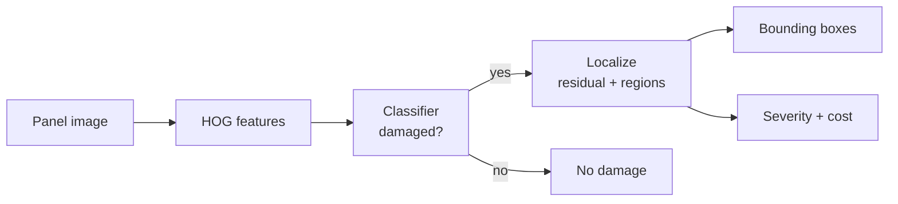

# DamageScope

**Vehicle damage detection with computer vision.**

DamageScope looks at a photo of a car panel and answers three questions: is there damage,
where is it, and how bad is it. It flags damage with a classifier, draws bounding boxes
around the damaged areas, estimates severity and a rough repair cost, and routes the
result into an insurance-style report. The trained model exports to ONNX so inference runs
on plain CPU.

> The images are **synthetic** (generated panels with scratches and dents). No real photos
> or claims are used.

[](.github/workflows/ci.yml)
[](pyproject.toml)
[](LICENSE)

---

## Why it exists

A car insurer gets thousands of damage photos. A first pass that says "damaged / not
damaged, here is where, roughly this severity" saves an adjuster a lot of time. This
project does that first pass with **classical computer vision**, which is honest about what
it is: it needs no GPU, runs fast, and every step can be explained.

## How it works



* **Detect.** The image is described with **HOG** features (the directions of its edges), and
  a random forest decides damaged or clean. A scratch or dent adds strong oriented edges that
  a smooth panel does not have, so the two are easy to separate.
* **Localize.** A clean panel is smooth, so it almost equals a blurred copy of itself. Damage
  is high-frequency, so it stands out in the difference ("residual"). We threshold the
  residual, group the bright pixels into regions, and draw a box per region.
* **Score.** Severity comes from the damaged-area fraction and the number of regions; a simple
  model turns that into a rough repair cost.

The classifier and the localizer are both measured: ROC-AUC for detection, and **IoU**
(Intersection over Union) against the true damage boxes for localization.

## Results on the synthetic set

```
detection : accuracy 0.85  precision 0.93  recall 0.76  ROC-AUC 0.91
localization: mean IoU ~0.80
ONNX inference matches scikit-learn exactly
```

## Quickstart

```bash
python -m venv .venv && source .venv/bin/activate
make install
make demo          # train, inspect a damaged and a clean panel, score localization
make test          # full test suite
make train         # train and save the model
make export        # export the model to ONNX
make run           # serve the API on http://localhost:8000 (docs at /docs)
```

### The API

| Method | Path | What it does |
|---|---|---|
| `GET` | `/health` | Liveness check |
| `GET` | `/model` | Active model version and metrics |
| `POST` | `/inspect` | Upload a panel image; get damage, boxes, severity, cost |

```bash
curl -s -F "file=@panel.png" http://localhost:8000/inspect
```

## ONNX for CPU

The scaler and random forest export to **ONNX** (`make export`), so serving needs only
`onnxruntime`, not scikit-learn. HOG feature extraction stays in Python; the model runs in
ONNX. A test checks that the ONNX output matches scikit-learn exactly.

## Project layout

```
damagescope/
  generate.py   synthetic panels with scratches/dents (+ true boxes and mask)
  features.py   HOG features
  model.py      random forest classifier + ONNX export
  localize.py   residual-based localization, bounding boxes, IoU
  severity.py   severity level and a rough repair cost
  onnx_infer.py CPU inference with onnxruntime
  service.py    the flow (classify -> localize -> severity)
  main.py       FastAPI endpoints
  cli.py        train / export / demo
```

## Testing and quality

* **19 tests** cover the generator, features, the classifier, ONNX parity, localization and
  IoU, severity, the service, and the API. CI requires at least 80% coverage.
* `ruff` for lint, `bandit` and `gitleaks` for security.

See [`docs/architecture.md`](docs/architecture.md), the [ADRs](docs/adr/), and the Spanish
study guide in [`docs/estudio/`](docs/estudio/).

## Honest limits

This is a classical-CV baseline on synthetic images. Real photos have backgrounds,
lighting, dirt, and many damage types, so a production system would use a trained deep model
(a CNN detector or segmenter) on real labelled photos. The value here is the end-to-end
shape — detect, localize, score, serve, export — and an honest, measurable baseline to beat.

## License

[MIT](LICENSE) © Angelo David Padilla Romero
