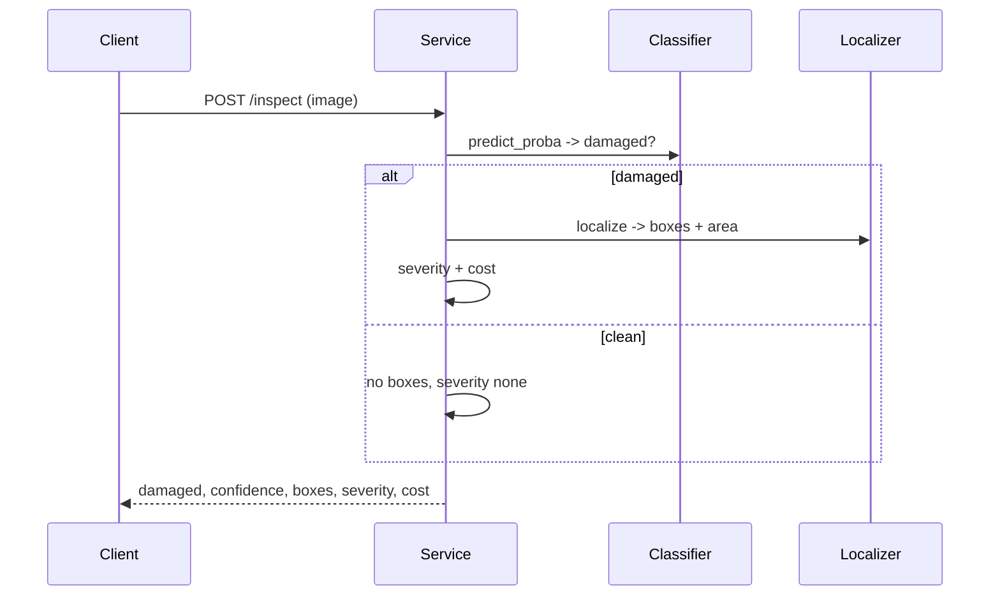

# Architecture

## Goal

Given a photo of a car panel, say whether it is damaged, where the damage is, and how bad
it is — fast, on CPU, and with every step explainable.

## Components

| Layer | Module | What it does |
|---|---|---|
| Data | `generate.py` | Synthetic panels with scratches and dents (+ true boxes/mask) |
| Features | `features.py` | HOG features |
| Model | `model.py` | Random forest classifier + ONNX export |
| Localize | `localize.py` | Residual-based localization, bounding boxes, IoU |
| Severity | `severity.py` | Severity level and a rough repair cost |
| ONNX | `onnx_infer.py` | CPU inference with onnxruntime |
| Flow | `service.py` | Ties the steps together |
| API | `main.py` | FastAPI endpoints |

## Detection: HOG + random forest

HOG (Histogram of Oriented Gradients) describes an image by the directions of its edges in
small cells. Damage adds strong, oriented edges (the sharp line of a scratch, the rim of a
dent); a smooth panel does not have them. So a classifier on HOG features separates damaged
from clean well, with no deep network. We use a random forest because it is accurate on
these features, fast, and exports cleanly to ONNX.

## Localization: residual + connected components

A clean panel is smooth, so it nearly equals a blurred copy of itself. Damage is
high-frequency, so it does not. We compute the **residual** = |image − blurred image|,
threshold it at mean + k·std, close small gaps, group the bright pixels into connected
regions, and return a bounding box per region above a minimum area. Broad specular
highlights are smooth, so the residual ignores them — that is why the generator adds them,
to make the test fair.

## Measuring both parts

* **Detection** is measured with accuracy, precision, recall, and ROC-AUC on a held-out
  split.
* **Localization** is measured with **IoU** (Intersection over Union) between predicted and
  true boxes. For each true box we take the best IoU against any predicted box and average.
  Because the generator keeps the true boxes, this score is real, not guessed.

## ONNX export

`model.py` exports the scaler + random forest to ONNX with `skl2onnx`. At serving time you
load the ONNX file with `onnxruntime` and do not need scikit-learn. HOG stays in Python; the
model runs in ONNX. A test checks the ONNX output matches scikit-learn within a tiny
tolerance.

## The flow

## Configuration

Settings use the `DS_` prefix (see `.env.example`): the model directory, the image size, the
residual threshold sigma, the minimum region area, and the severity thresholds.
